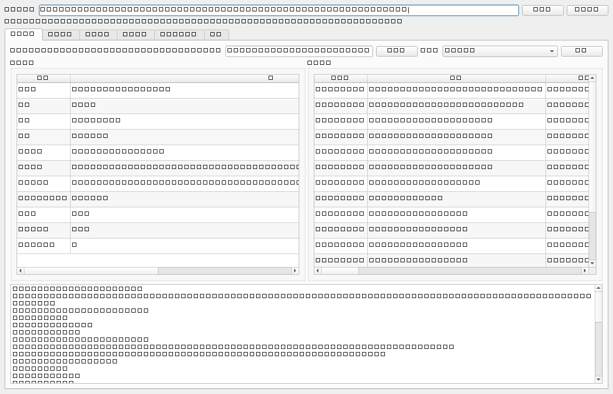
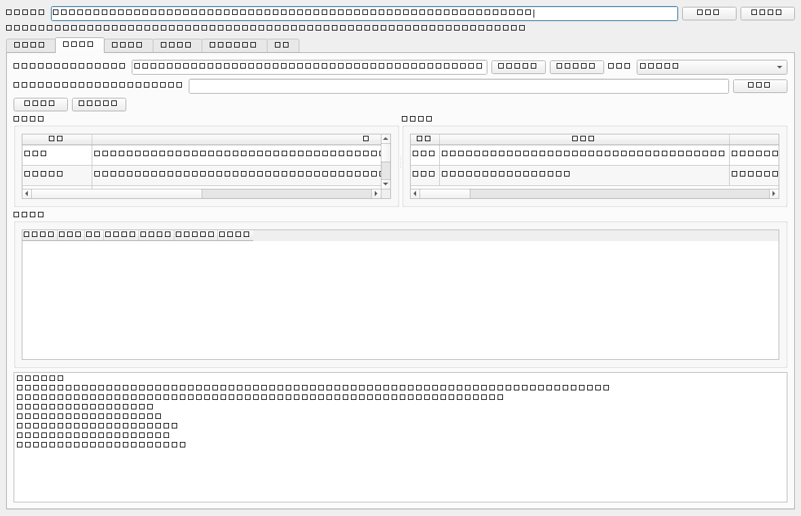
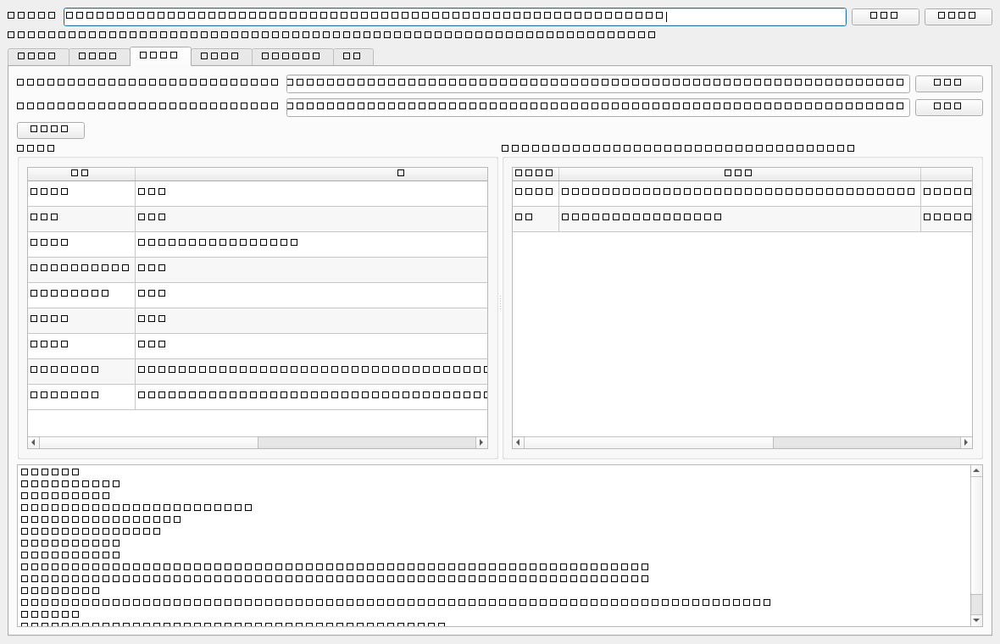

# AI 生成合成内容标识合规核查器

> 本地目录 `10-13-ai-content-labeling-checker`（`10-13` = 2026-10-13 日期标签）。GitHub 仓库名发布时用纯净名 `ai-content-labeling-checker`，见 [plan/00-README总览.md](plan/00-README总览.md)。

以《人工智能生成合成内容标识办法》（**国信办通字〔2025〕2 号**，2025-09-01 施行）与强制性国家标准 **GB 45438-2025**《网络安全技术 人工智能生成合成内容标识方法》为规则源，把**显式标识 + 隐式元数据标识**的合规核验做成**规则化、可批量、留指纹证据**的本地工具（桌面 exe + CLI 双形态）。

**全本地核查、零上传**：被核查内容可能含商业敏感信息，工具默认不联网，且**不做任何去水印/标识规避**（明确非目标）。

> 状态：✅ **v0.2.0 已发布（2026-10-19）**——GitHub Release 挂免安装双 exe zip；CI 8 job 全绿
> （含新增 `package` job 真构建 + 真验收）；本地 py3.12 全量 **465 passed**。上一版留档见
> [plan/RELEASE-M6.md](plan/RELEASE-M6.md)，本版说明见 [plan/RELEASE-NOTES-v0.2.0.md](plan/RELEASE-NOTES-v0.2.0.md)。
> v0.1.0 = GitHub 仓库 + **Release v0.1.0**（挂免安装双 exe 的
> ASCII 命名 zip）；发布前经**脱敏四步审计**（`tools/audit_desensitize.py`：内容扫描 + 提交邮箱 +
> 资产口径 + 版权口径 + 产物本体扫描，含探测器阳性/阴性对照），内容侧**阻断项 0**，提交邮箱已全历史
> 改写为 GitHub noreply。CI 8 job 全绿；发布物本体经下载核 sha256 + 中立目录冻结态自检。
> 完整留档见 [plan/RELEASE-M6.md](plan/RELEASE-M6.md)；上一棒 M5 见 [plan/HANDOFF-M6.md](plan/HANDOFF-M6.md)。

---

## 它解决什么问题

| 痛点 | 本工具的能力 |
|---|---|
| 我产出的内容"标识到底合不合规"没有确定性口径 | 规则库驱动的确定性核验（结论逐条挂条款依据） |
| "有没有标识"好判，"位置/形式对不对"难判 | 显式标识**要素级 + 位置级**判定 |
| 隐式标识藏在元数据里，字段名各容器不一 | **字段映射引擎**（容器键 → 国标字段）+ 字段级核验 |
| 单件结论无意义，要成表才能整改 | 完整性分级（完全合规/部分合规/不合规）+ 缺失项清单 |
| 内容量以千计，逐件点开不现实 | **批量扫描** + 失败件隔离（M3） |
| 整改是循环的，"这轮比上轮好了没" | **两轮对账**：新增违规 / 已修复 / 持续违规（M3） |
| 结论要能交给同事/监管/存档 | **报告导出**：Markdown + CSV + XLSX（含范围/依据/逐件逐字段/结论，M3） |
| 报告可能被改，结论要能复现对照 | 每件内容指纹（sha256）+ **报告自身 sha256** 进证据链（M3） |
| "核验到底准不准"没有证据 | **内置评测基准**（字段规则/构造真值/对账三类，零 API 可重复，M4） |
| 规则会变，旧结论要用旧口径复现 | **版本化规则库**（依据文件 × 版本），切换即切口径 |

## 规则库版本化与 status 门控（本项目的核心纪律）

规则库按 **`依据文件 × 版本`** 组织（`data/rules/`），条款编码为可执行核查规则（JSON）。每条挂文号/标准号与 `status`：

- `verified` —— 已逐条挂原文核对，**可进入判定路径**；
- `pending` —— 待核对，**绝不参与任何判定**。

**未挂原文核对的条目不得落库生效**——这是"不编造条号、不输出假合规"的工程落点。规则库切换（`registry.json` 的 `active`）即切换核查口径。

> **当前状态（M2）**：GB 45438-2025 的 25 条规则已逐条挂原文（国家标准全文公开系统逐页）核对并转 `verified`，**已进入判定路径**；
> 《标识办法》9 条中，**办法独有义务**（第四条第二款导出文件、第六条传播平台提示）已在 M2 适用性画像后转 `verified`，
> 与国标同目标（显式四载体 + 隐式三要素）的 7 条保持 `pending`（技术判定由国标承担，避免同一目标跨文档重复判定）。
> 因此：
> - 示例件 `card-text-basic.json`（全要素齐备）→ `compliant`（退出码 0）；
> - 边界件 `card-image-metadata-stripped.json`（元数据被剥离但显式标识在）→ `non_compliant`（退出码 1），`missing` 列出被剥离字段。
>
> 若某数据目录的规则条目**全部** `pending`，或当前场景/载体下无任何规则适用，`check` 会如实输出
> `not_assessed`（"未进行评估"）而非 `compliant`——**"没查出问题"与"没检查过"绝不等同**。

## 两条输入通路

| 通路 | 输入 | 说明 |
|---|---|---|
| **结构化标识卡**（主通路） | `card.json`（`LabelCard`：显式要素 + 隐式字段字典 + 指纹） | 确定性、可基准；人工录入或上游系统产出 |
| **容器解析通路**（M2 新增） | PNG / JPEG / MP4 / M4A 文件 | 抽取容器元数据里的 **AIGC 载荷**（GB 45438-2025 附录 E 格式）→ 同一标识卡；解析不到**显式降级**，绝不臆测 |

**能力（M2 已落地）**：

- **显式标识核验**：要素存在性 + **位置/形式**（FR-2）逐条判定，挂条款依据；
- **隐式元数据核验**：字段映射引擎（容器键 → 国标字段）+ 存在性/类型/枚举/格式/取值判定；
- **§6.1 c) 唯一性**：文件元数据隐式标识须**仅保留一份**（重复提供 → 违规）；
- **适用性画像**：场景（产出/导出/传播）+ 观测作用域——**不适用记 `skipped`、未观测记 `unknown`**，
  既不冤枉用户也不给假结论；
- **解析降级留痕**：结构坏/无载荷/容器不识别，各自原因码进报告（`parse` 块）。

## 内置评测基准（M4：核验正确性的可复现证据）

"没有标注数据，核验正确性无法证明"——本工具把正确性做成**可重复、零 API、零外部依赖**的指标：
`labelcheck bench` 一条命令跑三类基准，指标如下（**本仓库真实规则库 + 随附算例**实测）。

| 基准 | 内容 | 指标 | 实测 | 达标线 |
|---|---|---|---|---|
| `fields` | 逐 `check_type` 的枚举用例（存在性 / 位置 / 格式 / 取值 / 类型 / 唯一性 / 场景门控），含**边界与畸形输入** | 判定准确率 | **100%**（30/30） | 100% |
| `constructed` | 程序化构造带**已知标识配置**的合成件（正确 / 缺字段 / 错取值 / 错格式 / 错位置 / 元数据剥离 / 显式缺失 / 重复保留 / 场景义务 / 未观测） | 检出率 | **100%**（23/23） | ≥ 95% |
| | | 误报率 | **0%**（0/11） | 0（硬口径） |
| `diff` | 两轮扫描差异对账的确定性验证（新增违规 / 已修复 / 持续违规 + 全部辅助集合） | 对账集合一致率 | **100%**（2/2） | 100% |

```bash
labelcheck bench              # 三类全跑；退出码 0 达标 / 1 未达标 / 2 用法错误
labelcheck bench --only fields,diff   # 只跑指定基准
labelcheck bench --json       # 机器可读（供 CI / 二次加工）
```

**口径（可对照、可复现）**：

- **对账口径唯一实现**：非 pass = `fail ∪ unknown`；**未观测的 scope 排除在比较之外**
  （解析通路的显式作用域恒为"未观测"，那是"没看到"而非"缺失"）。真值库测试
  （`tests/test_generators.py`）、解析回归（`tests/test_parse_regression.py`）与基准
  **共用同一实现**（`benchmark/cases.py`），不会出现"基准说达标、测试说不过"。
- **期望值不抄引擎**：由**注入点**推出（"注入了字段 F 缺失 → F 应判 fail"）；合规取值/位置/枚举
  **从规则库派生**，故规则库一变基准跟着变——基准对口径漂移**敏感**，不是自证自话。
- **误报率是硬口径 0**：把合规件判成违规比漏检更伤用户信任，故单列为"越小越好"的指标。
- **零 API / 纯规则通路**：`benchmark/` 零第三方依赖、零系统时钟（守门测试锁死）；本机 py3.12 进程内 5 次实测 **0.209–0.236 s**（参考值，随机器变化；旧文档的 0.12 s 已作废）。
- 复现：`python -m pytest tests/test_benchmark_runner.py`（仓库数据下三类基准必须全部达标）。

## 桌面界面与双 exe（M5）

同一套引擎既有命令行、也有桌面界面——**界面只渲染引擎结果，零判定逻辑**
（`gui/services.py` 是唯一引擎调用点，只调 `engine.check_file` / `scan.scan_target` /
`scan.diff_scans` / `benchmark.run_benchmark`，故界面与 CLI 结论必然一致）。



| 页签 | 做什么 | 对应能力 |
|---|---|---|
| 单件核验 | 选文件 → 概要 + 逐条判定 + 可复制结论文本 | `check` |
| 批量扫描 | 选目录/清单 → 逐件结果 + 一键导出报告 | `scan` |
| 两轮对账 | 选两份结果 JSON → 新增违规/已修复/持续违规/内容变动 | `scan --baseline` |
| 基准指标 | 三类内置基准的实测值与达标线 | `bench` |
| 规则库与依据 | 规则库坐标、依据清单、规则条目、字段映射 | `selfcheck` 的展开 |
| 关于 | 工具定位与免责声明 | — |

```bash
python -m pip install -e ".[gui]"   # 安装界面依赖（PySide6）
labelcheck gui                      # 启动桌面界面
labelcheck gui --check              # 只做可加载性自检（无显示环境/CI 冒烟）
```





**打包成免安装 exe**（PyInstaller onedir 双 exe；无 Python 的机器也能用）：

```bash
python -m pip install -e ".[pkg]"   # 安装打包依赖（PyInstaller）
python -m tools.build_exe           # 构建 + 自动校验（任一断言不过即非零退出）
python tools/verify_package.py      # 中立环境验收（清环境变量 + 以 exe 目录为 CWD）
```

| 产物 | 形态 | 用途 |
|---|---|---|
| `dist/labelcheck-gui/labelcheck-gui.exe` | 窗口版（无控制台） | 双击即用的桌面界面 |
| `dist/labelcheck/labelcheck.exe` | 控制台版 | 脚本化 / 无 GUI 机器（可管道取 JSON、判退出码） |

> **内嵌数据走白名单**（`rules`/`mapping`/`truth`/`parse`/`samples`/`knowledge`），不整仓塞 `data/`；
> 构建后**必须验伪**——断言冻结态解析到的数据目录**落在 dist 之内**（否则可能兜底命中仓库数据，
> 出现"本机能跑、换机就崩"）。体积口径：**v0.1.0 Release 附件实测** CLI 文件夹 17 MB / GUI 112 MB
> （zip 7,401,819 B / 45,767,613 B）；**v0.2.0 本机构建**（py3.12 + PySide6 6.12 + PyInstaller 6.22）
> CLI 19 MB / GUI 120 MB——**以你下载到的 Release 附件为准**，旧文档的 ≈13/≈158 MB 已作废。
> 演示素材由 `python tools/make_demo_assets.py` 离屏渲染真实界面产出（保证与当前代码一致）。

## 下载即用（免安装）

不想装 Python？直接下 **[Release v0.1.0](https://github.com/yuluo554/ai-content-labeling-checker/releases/tag/v0.1.0)**：

| 附件 | 形态 | 用途 |
|---|---|---|
| `labelcheck-gui-v0.1.0-win64.zip` | 窗口版（无控制台） | 解压后双击 `labelcheck-gui.exe` |
| `labelcheck-cli-v0.1.0-win64.zip` | 控制台版 | 脚本化 / 无 GUI 机器（可管道取 JSON、判退出码） |

解压到任意目录即可运行（onedir 形态）。校验：`certutil -hashfile <zip> SHA256`
（sha256 值见 Release 说明）。

## 快速开始

要求 Python 3.12+（无第三方依赖即可跑核心功能；3.8 已于 2024-10-07 EOL，v0.2.0 起不再支持）。

```bash
python -m venv .venv
# Windows(Git Bash): source .venv/Scripts/activate    Linux/macOS: source .venv/bin/activate
python -m pip install -U pip
python -m pip install -e ".[dev]"     # 开发依赖：pytest、pyyaml（CI 守门测试用）
```

```bash
# 自检：数据目录定位 + 规则库加载 + status 门控计数
labelcheck selfcheck

# 单件核验（人类可读 / JSON 两路）
labelcheck check data/samples/card-text-basic.json
labelcheck check data/samples/card-image-metadata-stripped.json --json

# 核验可解析容器文件（M2）：抽取元数据标识后核验
labelcheck check photo.png
labelcheck check clip.mp4 --scenario propagated

# 只解析容器（M2）：产出标识卡供上游消费
labelcheck parse photo.png --json
labelcheck parse clip.mp4 --out card.json

# 批量扫描（M3）：目录或清单（每行一路径）→ 逐件核验；失败件隔离不中断
labelcheck scan ./content-dir --out ./report-out
labelcheck scan ./manifest.lst --json > round2.json

# 两轮对账（M3）：拿上轮结果比对本轮，输出新增违规/已修复/持续违规
labelcheck scan ./content-dir --baseline round1.json --out ./report-out

# 内置评测基准（M4）：字段规则 / 构造真值 / 两轮对账三类，指标见上方表格
labelcheck bench
labelcheck bench --json

# 额外导出格式（v0.2.0，只读旁路；不进默认报告包、不改证据链指纹）
labelcheck scan ./content-dir --sarif results.sarif     # SARIF 2.1.0（接入代码扫描平台）
labelcheck scan ./content-dir --html report.html        # 单文件 HTML（内联 CSS、零 JS、零外链）

# 规则库只读查询（v0.2.0）：条目 / 字段映射 / 依据坐标
labelcheck rules                                        # 人类可读（缺省连 pending 一起列）
labelcheck rules --scope implicit --status verified      # 过滤
labelcheck rules --mapping --json                       # 含字段映射表，机器可读

# 版本与规则库坐标
labelcheck version

# 跑测试
python -m pytest -ra
```

> **`--scenario`**（M2）：`authored`（默认，产出内容）/ `exported`（下载导出）/ `propagated`（传播转发）。
> 场景决定哪些规则适用——办法第四条第二款与第六条只在对应场景生效，不适用记 `skipped`（不算违规）。

> **报告产物（M3）**：`scan --out DIR` 写出 `report.md`（人类可读）、`summary.csv`（每件一行）、
> `detail.csv`（每 finding 一行）、`evidence.json`（证据链）与 `report.xlsx`（装了 `openpyxl` 时；
> 缺失则**只导 CSV 并提示**，退出码仍 0，不崩）。**相同输入两次导出逐字节一致**（含 XLSX：
> 其内部时间戳已钉死），`evidence.json` 含报告自身 sha256 → 报告被改动即可检出。

> **额外导出（v0.2.0）**：`--sarif FILE` 与 `--html FILE` 写到**你指定的路径**，是对既有结果的
> **只读旁路**——默认五产物的字节与 `evidence.json` 指纹都不因此改变。SARIF 里 `fail → level`
> 由既有 `severity` 固定映射（critical→error / major→warning / minor→note），`unknown` 保留为
> `level=note`（抹掉它等于把"没检查"说成"没问题"），`skipped` 不导出。HTML 单文件内联样式、
> 零 JS、零外链（打开报告不产生任何联网）。

**退出码语义**（脚本化使用的契约，已被测试逐码锁死）：

| 码 | 含义 |
|---|---|
| `0` | 完成且未发现不合规项 |
| `1` | 完成但**检出不合规**（便于 CI/脚本分流；批量 `scan` 任一件 fail 即 1） |
| `2` | 用法/输入错误（参数错、文件不存在、JSON 坏、标识卡校验失败） |
| `3` | 环境/依赖错误（数据目录定位失败、规则库缺失/损坏） |

> 批量 `scan` 中的**失败件**（坏 JSON、不可解析、读盘失败）是"未判定"而非"违规"，
> **不**改变退出码（仍由是否检出 fail 决定）；失败件在结果与报告中单列，不会被静默吞掉。

> `bench`（M4）同用 0/1/2：**0 = 全部基准达标**，**1 = 有基准未达标**（脚本可按码拦住"指标回退"），
> `2` = 用法错误（未知基准名）。

## 项目结构

```
plan/                     计划与交接文档（00–06 + HANDOFF）
data/                     冻结数据资产（台账见 data/README.md）
  rules/                  版本化核查规则库（依据 × 版本，生成器产出）
  mapping/                元数据字段映射表（生成器产出，含解析画像）
  knowledge/raw/          官方依据快照（办法全文 + 国标核对记录 + 上位规章全文）
  truth/                  合成样本真值库（生成器产出，固定 seed）
  parse/                  解析通路算例（真实容器字节 + 植入真值，M2）
  samples/                示例标识卡（演示 check 通路）
src/labelcheck/           核心包（核心层零第三方依赖）
  paths.py                数据目录定位（源码态/冻结态四分支）
  rules/                  规则库加载 + status 门控 + 场景门控 + 判定分派
  mapping/                字段映射引擎（容器键 → 国标字段）
  parse/                  **容器解析通路**（PNG/JPEG/ISO BMFF → 标识卡，M2）
  engine/                 显式/隐式/完整性核验 + 端到端编排（含单点文件分派 check_file）
  scan/                   **批量扫描 + 两轮对账**（M3）
  report/                 **报告导出 + 证据链**（M3；openpyxl 惰性导入）
  benchmark/              **内置评测基准**（M4：cases 单一实现源 + 三 runner，零第三方）
  gui/                    **桌面界面**（M5：services 零 Qt 服务层 + format 渲染 + tabs 六页签 + main_window）
  packaging/              **打包支持**（M5：数据白名单 + 冻结态验伪 + 构建前置检查）
  cli/                    argparse 入口（check / parse / scan / bench / gui / rules / selfcheck / version）
docs/                     技术报告（技术报告.md）+ 演示素材（demo/，离屏渲染产出）
tests/                    全离线测试（含架构守门 + 生成器位级一致 + 解析回归 + 扫描/对账/报告 + 基准 + GUI/打包）
tools/                    生成器（gen_* 四个）+ 打包/验收（build_exe / verify_package / labelcheck.spec / entry_*）+ 演示素材 + 脱敏审计（audit_desensitize，发布门）
.github/workflows/        CI（test×2 / cli-smoke×2 / gui-smoke / packaging-guard×2 / package，全 py3.12）
```

架构分层与选型理由见 [plan/03-架构与技术选型.md](plan/03-架构与技术选型.md)；模块契约（规则库 schema、字段映射、分级算法、退出码、GUI/打包）见 [plan/04-模块详设.md](plan/04-模块详设.md)；技术报告见 [docs/技术报告.md](docs/技术报告.md)。

## 里程碑

| 里程碑 | 内容 | 状态 |
|---|---|---|
| M0 | 计划 00–06 定稿 + 可运行骨架（规则库加载/门控/引擎骨架/CLI/测试/CI） | ✅ 2026-10-13 |
| M1 | 数据先行：规则库逐条挂原文核对 + 字段映射表 + 合成样本真值库 + 台账 | ✅ 2026-10-13 |
| M2 | 显式/隐式核验引擎充实 + **解析通路首批载体** + **适用性画像** + 算例回归 100% | ✅ 2026-10-13 |
| M3 | **批量扫描** + **两轮对账** + **报告/证据链导出** | ✅ 2026-10-13 |
| M4 | **三类内置基准**（字段规则/构造真值/批量对账），**指标进 README** | ✅ 2026-10-13 |
| M5 | **PySide6 界面** + **PyInstaller 双 exe** + **演示素材** + **技术报告** | ✅ 2026-10-13 |
| M6 | **脱敏审计** + 发布 GitHub Release（exe）+ 收尾固化 | ✅ 2026-10-13（v0.1.0 已发布） |

## 限制与免责

- **首期范围**：《标识办法》+ GB 45438-2025 的文本/图片/音视频标识字段规范；其余载体留扩展。
- **解析通路范围（M2）**：结构化容器仅 PNG/JPEG/ISO BMFF（MP4·M4A）的**元数据**；纯文本文件
  不入解析通路（无元数据容器，"哪段文字是标识"需语义判断，交人工录入）。解析不到即
  **显式降级**为 `unknown`（原因码进报告），**绝不臆测**为合规或违规。
- **显式标识的解析盲区**：文件解析器读不到渲染后的画面文字/语音 → 解析通路的显式作用域
  恒为"未观测"（`unknown`）；要判显式标识，请用结构化标识卡录入实测信息。
- 规则条目的核对状态以规则库 `status` 为准；**`pending` 条目不参与判定**。
- 本工具的结论**供参考**，正式合规认定以监管口径为准。
- **本工具为合规辅助，不提供任何去水印/标识规避功能**（明确非目标，见 [plan/02](plan/02-需求解读.md) §4.1）。

## 许可

MIT，见 [LICENSE](LICENSE)。
